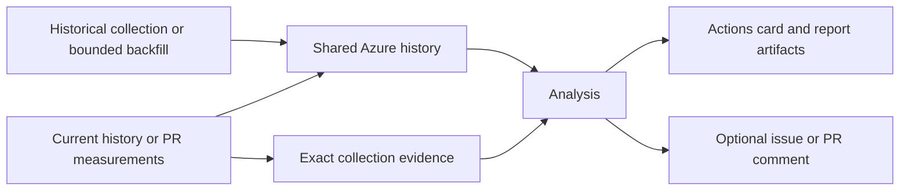

# Benchmark history action

Collect benchmark history, compare current measurements with comparable history,
and read the result in GitHub Actions. Optional issue and PR updates bring findings
to the conversation without making regressions a build failure.

Use the [ordered GitHub onboarding guide](https://folo-rs.github.io/folo/cargo-bench-history/github-automation.html)
for the complete journey, [Read a report](https://folo-rs.github.io/folo/cargo-bench-history/appendix/reporting.html)
for the production-generated report gallery, and [Investigate and accept](https://folo-rs.github.io/folo/cargo-bench-history/appendix/insights.html)
for decisions about a finding. The [input/output and custom-workflow reference](docs/reference.md)
keeps advanced composition separate from the starter below.



Backfill only collects history; run history or PR analysis afterward.

## Minimal starter

### Check your benchmarks and runners

Start with an existing Rust package or workspace whose benchmarks run locally.
Supported engines are Criterion, Callgrind through Gungraun, `alloc_tracker` and
`all_the_time`; see [engine requirements](https://folo-rs.github.io/folo/cargo-bench-history/concepts/engines.html).
The action does not create benchmarks or turn arbitrary test output into measurements.
Root-package and single-crate repositories are supported: unknown or root ownership
conservatively selects the full workspace rather than discarding the package.

Collection defaults to `ubuntu-latest` (x64 Linux) and `windows-latest` (x64 Windows),
with **all Cargo features enabled**. Apple Silicon `macos-latest` is optional;
Intel macOS is not a supported release target. Choose only platforms your benchmarks
and dependencies support. The reusable workflows require GitHub.com runner 2.336.0
or later, PowerShell 7.6 or later, Cargo and the project's Rust/system prerequisites.
The [release manifest](release.json) is the authority for native tool targets.

For incompatible feature combinations, set `all-features: false` and choose
`features` and, if needed, `no-default-features`. Restrict Cargo benchmark targets
with `bench` and packages with `exclude`; there is no reusable-workflow package-list
or Rust target-triple override. `platforms` selects supported native runners, not
cross-compilation. Keep these choices, compiler flags, compiler and engine versions
the same in history, PR and backfill callers: they form your measurement protocol.

### Commit configuration and connect Azure

Commit `.cargo/bench_history.toml` with a stable project identity and your selected
storage names. Replace these example values with your deployment's values:

```toml
[project]
id = "my-project"

[storage.azure]
account = "myhistoryaccount"
container = "bench-history"
```

Install the [CLI](https://folo-rs.github.io/folo/cargo-bench-history/installation.html)
on the machine used for provisioning, then follow the canonical
[`setup-azure` guide](https://folo-rs.github.io/folo/cargo-bench-history/commands/setup-azure.html)
to prepare its prerequisites, provision or reuse storage and configure
short-lived federated access for your repository and history branch. Reconcile the
committed account/container with the command's printed configuration.
The examples below use `main`; change their branch names together with the
deployment's trusted history branch.

Under **Settings > Secrets and variables > Actions > Variables**, set
`AZURE_CLIENT_ID` to the printed managed-identity **client** ID and `AZURE_TENANT_ID`
to its tenant ID. These are nonsecret repository variables. Reusable callers pass
them as inputs; do not add an `azure/login` job, static credentials, or duplicate
checkout/full-history/environment preparation.

### Prepare benchmark prerequisites

If the runner already has all prerequisites, no hook is needed. Otherwise copy
the executable [setup action](.github/actions/bench-history-setup/action.yml) to
the **same path in your repository**, `.github/actions/bench-history-setup/action.yml`.
Set repository variable `BENCHMARK_RUST_TOOLCHAIN` to your tested exact Rust version,
or a dated nightly if your benchmarks actually require nightly. The recipe installs
that toolchain and selects it for current collection. It does not assume every
Rust project needs nightly. Historical backfill clears the launcher's
`RUSTUP_TOOLCHAIN` and `CARGO` overrides: each historical checkout resolves its own
toolchain, including its committed `rust-toolchain.toml`. The hook does not
override those historical pins. Choose a compatible range and see
[backfill toolchain configuration](https://folo-rs.github.io/folo/cargo-bench-history/commands/backfill.html#toolchain-and-measurement-configuration).

For Gungraun, also set `BENCHMARK_GUNGRAUN_VERSION` to the exact `gungraun` version
used by your benchmarks. The recipe installs a matching `gungraun-runner` and the
Linux distribution's Valgrind package. Select `platforms: ubuntu-latest` in **all**
callers for this recipe; it explicitly rejects the Gungraun setup on Windows and
Apple Silicon macOS. Leave the variable unset for engines without this dependency.
Use a historical range compatible with that engine/runner version.

The hook is fixed, takes no checkout-path inputs, and runs from the **invocation
checkout**, which supplies configuration and setup code. Current/PR measurements
run in a separate frozen checkout; backfill creates historical worktrees.
Runner-wide tools and ordinary `GITHUB_PATH`/`GITHUB_ENV` changes reach subsequent
work, subject to backfill's toolchain isolation described above.
Generating files or running `cargo build` in the invocation root does **not** prepare
the measured worktree. If a project needs checkout-specific generation, use the
[root action in a caller-owned graph](docs/reference.md#advanced-root-action-reference);
there is no per-historical-checkout hook to invent or configure.

### Collect history and find the first result

Commit `.github/workflows/benchmark-history.yml`:

```yaml
name: Benchmark history
on:
  push:
    branches: [main]
  workflow_dispatch: {}
jobs:
  benchmark-history:
    if: github.ref == 'refs/heads/main'
    permissions:
      contents: read
      actions: read
      id-token: write
      issues: write
    uses: folo-rs/cargo-bench-history-action/.github/workflows/history.yml@v3
    with:
      azure-client-id: ${{ vars.AZURE_CLIENT_ID }}
      azure-tenant-id: ${{ vars.AZURE_TENANT_ID }}
```

Push or dispatch on the trusted branch. Open **Actions > Benchmark history > the
run > Summary**. The result card is independent of GitHub publication and remains
available with `publish: false` or no findings issue. After successful analysis,
the run's **Artifacts** section and card link to
`bench-history-report-<project>-<run-id>-<attempt>` containing `summary.md`,
`report.md` and `report.json`. PR reports use the `pr-bench-history-report-` prefix.
Start with the vertical findings and compact range sketches in `summary.md`;
open `report.md` for detailed plots, machine metadata and inspection commands.
Preparation/installation failures instead get execution-only diagnostics; hard
cancellation can prevent even finalization.

Read the card in this order:

| Card evidence | What it establishes | Useful next action |
| --- | --- | --- |
| Execution succeeded | The selected work ran successfully, not that benchmarks are clean. | Read analysis and coverage. |
| Insufficient or incomplete evidence | Some requested comparisons cannot be judged. | Inspect coverage reasons and comparable history. |
| Nothing in scope | Analysis found no in-scope series; an empty prepared package scope instead runs no analysis. | Check target selection, exclusions and analysis ignore prefixes. |
| Findings or clean disposition | A checked analysis result for the disclosed scope and coverage. | Read the report and its warnings, not just the regression count. |
| Publication disabled or no new post | No GitHub write was requested, or lifecycle rules left posts unchanged. | Use the Actions artifact; no findings issue is required for a first run. |

An empty findings array, zero regressions or a green Actions run does not prove
healthy or complete evidence. A useful partial report can coexist with a failed
platform job. An open issue is a separate lifecycle fact: an all-clear update
leaves the rolling issue open.

### Bootstrap a comparable baseline with bounded replay

Use normal history pushes to accumulate distinct commits, or commit this manual
caller as `.github/workflows/benchmark-backfill.yml` to seed an existing history:

```yaml
name: Backfill benchmark history
on:
  workflow_dispatch:
    inputs:
      from:
        description: First historical commit
        required: true
        type: string
      to:
        description: Last historical commit
        required: true
        type: string
jobs:
  backfill:
    if: github.ref == 'refs/heads/main'
    permissions:
      contents: read
      actions: read
      id-token: write
    uses: folo-rs/cargo-bench-history-action/.github/workflows/backfill.yml@v3
    with:
      azure-client-id: ${{ vars.AZURE_CLIENT_ID }}
      azure-tenant-id: ${{ vars.AZURE_TENANT_ID }}
      from: ${{ inputs.from }}
      to: ${{ inputs.to }}
      # Start with a small cost budget, then inspect the completion card.
      max-commits: '2'
```

Dispatch on the trusted branch with endpoints on one first-parent history whose
benchmarks build under the selected protocol. The range is inclusive. Each platform
attempts the newest missing commits, skips existing measurements without spending
its budget, and reports deferred work. Rerun to continue; this is a commit budget,
not a time limit. See the [backfill reference](docs/reference.md#backfill-historical-measurements)
for rolling windows, queuing and completion artifacts.

Backfill neither analyzes nor publishes. Run history again afterward and inspect
judged coverage. Same-commit reruns do not create distinct historical observations.
A number of calendar days or a minimum point count is not a reporting guarantee:
the baseline must be comparable for the selected engine, target and machine.
[Operations](https://folo-rs.github.io/folo/cargo-bench-history/operations.html)
explains readiness, cost, protocol changes and retention decisions.

### Add PR comparison and optional publication

Commit `.github/workflows/benchmark-pr.yml`:

```yaml
name: PR benchmark history
on:
  pull_request:
    types: [opened, synchronize, reopened, closed]
jobs:
  benchmark-history:
    if: github.event.pull_request.head.repo.full_name == github.repository
    permissions:
      contents: read
      actions: read
      id-token: write
      pull-requests: write
    uses: folo-rs/cargo-bench-history-action/.github/workflows/pr.yml@v3
    with:
      azure-client-id: ${{ vars.AZURE_CLIENT_ID }}
      azure-tenant-id: ${{ vars.AZURE_TENANT_ID }}
```

No caller matrix or package list is needed. PR preparation selects affected
benchmark packages and dependents, then applies exclusions. The `closed` event
supersedes older PR work without new collection.

History issues and PR comments are enabled by default. Add `publish: false` to
either caller to disable **GitHub** report, lifecycle and alert writes. Collection,
Azure reads/writes, analysis and artifacts continue. It does not reduce statically
requested token permissions: retain the caller permissions shown above, including
`actions: read`, even when publication is disabled.

Fork-origin PR work is skipped. Under GitHub defaults, the platform removes effective
fork-PR `id-token` capability after YAML evaluation; approval does not elevate it.
That server-enforced restriction, not an editable `if`, is the authorization barrier.
Nondefault write-token exceptions are outside this starter. Do not use
`pull_request_target` to run untrusted code with storage or publication access.

## Operate and upgrade

| Symptom | Where to look | Useful next step |
| --- | --- | --- |
| No report or empty scope | Actions card, preparation logs, selected targets and ignore configuration | Distinguish no analysis from `nothing_in_scope`; confirm a supported engine emits measurements. |
| Insufficient comparable baseline | Report coverage reasons and selected partitions | Collect distinct comparable history or resume bounded replay, then analyze again. |
| Partial/missing platform | Card platform list and failed collection job | Repair that platform; a surviving report does not turn its failure green. |
| Preparation, install, upload or publication failed | Failed stage logs and any retained local/report artifact | Fix the actual stage; source success is not proof that published binaries exist. Failure alerts are best-effort and may be unavailable before preparation or installation completes. |
| Findings look stale | Frozen analyzed commit, run/attempt and newer runs | Use current evidence; an old issue does not establish current-head freshness. |
| Issue remains open after all-clear | Issue's latest analysis and coverage | Treat open/closed as lifecycle state, not a regression verdict. |
| Backfill queued, bounded or no work | Collection-only card, frozen range, stop reason and completion bundle | Wait for queued work, resume deferred commits, or adjust an ineligible range; then run analysis separately. |
| Completion unavailable after interruption | Platform job and completion artifact | Treat counts as unknown, not zero; inspect storage/evidence before resuming. Hard cancellation may prevent finalization. |

Use [Investigate and accept](https://folo-rs.github.io/folo/cargo-bench-history/appendix/insights.html)
to inspect a finding and record an intentional change. Use
[Operations](https://folo-rs.github.io/folo/cargo-bench-history/operations.html)
for storage cost, bounded replay, retention and upgrades. These workflows do not
provide automatic retention cleanup. Existing measurements are preserved; changing
a protocol does not rewrite stored history or guarantee comparable baselines.

The v3 caller contract requires `actions: read` for **backfill as well as history
and PR** so result cards can select executed-attempt evidence. This required
permission is the reason for the action's 3.0.0 major boundary. When upgrading,
add it to every caller and select the same action revision and measurement protocol
across all flows. The examples describe the v3 contract, not publication status:
check [available releases](https://github.com/folo-rs/cargo-bench-history-action/releases)
before selecting a version. `@v3` follows compatible releases; a published full
version tag or commit SHA fixes the action revision and its exact tool pins.
